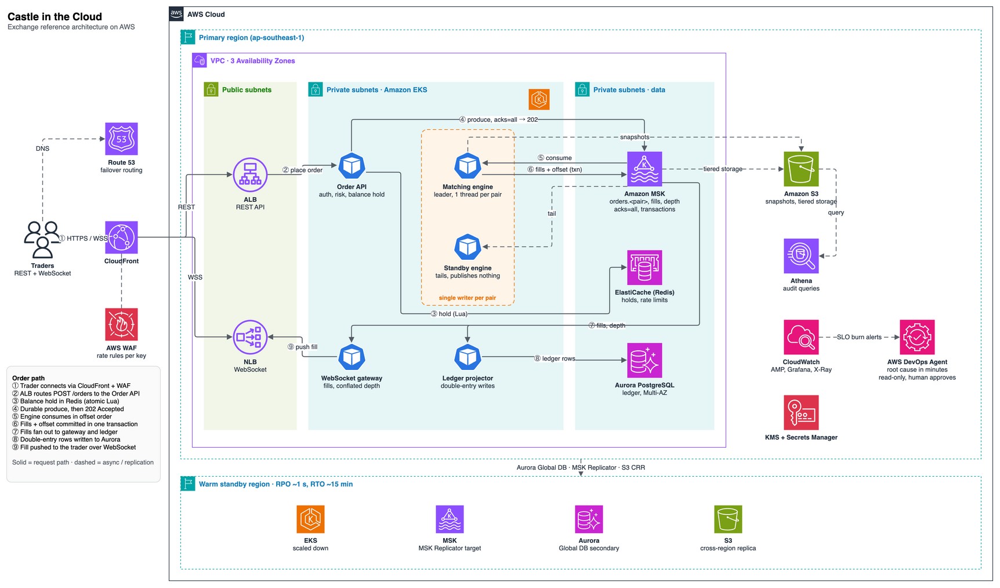
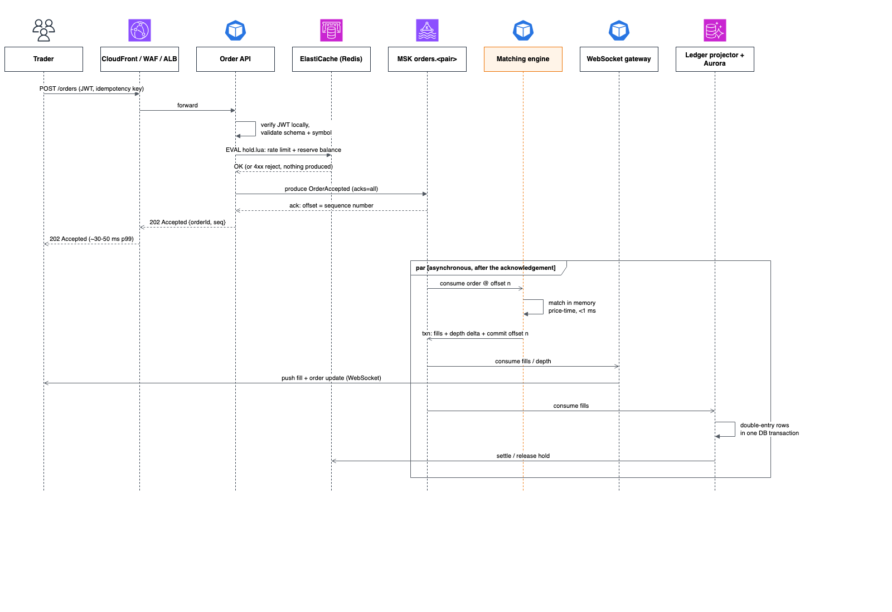
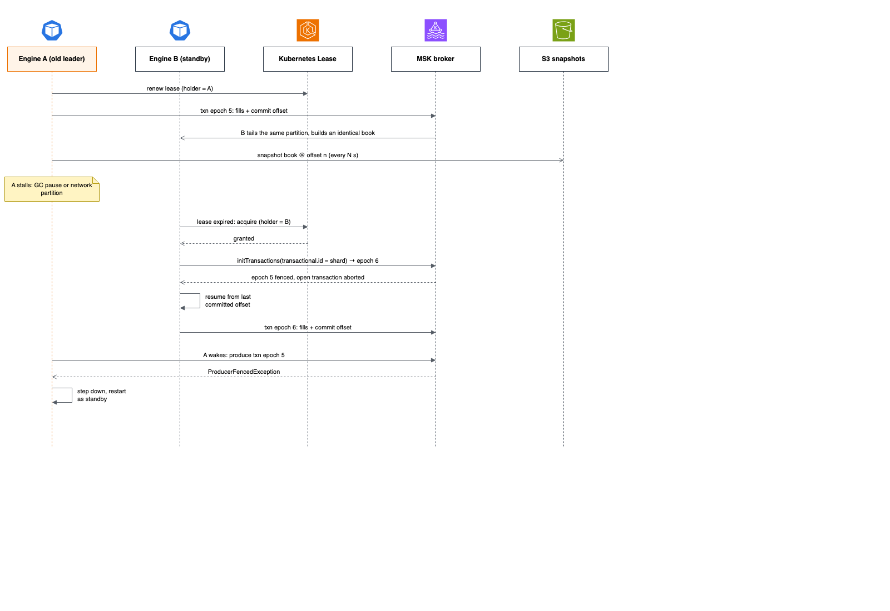

# Castle in the Cloud — Exchange System Design on AWS

A design for a crypto exchange's order-matching platform on AWS. Every order is durably written to Kafka (Amazon MSK) before the API acknowledges it, and everything else is derived from that log.



## Contents

- [Overview](#overview)
- [Architecture](#architecture)
- [Order flow and latency budget](#order-flow-and-latency-budget)
- [Matching engine](#matching-engine)
- [Component choices](#component-choices)
- [High availability and disaster recovery](#high-availability-and-disaster-recovery)
- [Scaling plan](#scaling-plan)
- [Security, operations and cost](#security-operations-and-cost)
- [Diagrams](#diagrams)

## Overview

**Features covered.** Out of Binance's feature set this design focuses on spot trading: placing and cancelling limit and market orders, price-time matching, live market data (trades and order-book depth over WebSocket), and the balance ledger that settles fills. Accounts and auth are included only as far as the order path needs them. Futures, margin, staking, fiat on-ramps and custody are out of scope; custody is added in Problem 5.

**Requirements** (from the challenge brief, with the HA and correctness targets added as assumptions)

| Requirement | Target |
| --- | --- |
| Throughput | 500 order requests/s sustained |
| Latency | p99 < 100 ms for order placement |
| Availability | Highly available; no acknowledged order lost on a node or AZ failure |
| Cloud | AWS |
| Correctness | Strict price-time priority per trading pair |

**Key decisions**

1. The Kafka log is the source of truth. The partition offset is the official sequence number for each trading pair.
2. The matching engine is a deterministic, single-threaded state machine that consumes the log and keeps each order book in memory.
3. The ledger, trade history and market data are projections of the log, rebuilt by replay.
4. The API returns `202 Accepted` after the durable write, not after the match. This is what makes a sub-100 ms p99 achievable; fills reach the client over WebSocket.

Recovery is "load the last snapshot, replay from its Kafka offset", so the system stays highly available without distributed transactions.

## Architecture

Orders flow through one sequencing point per trading pair; the matching engine is the only writer of fills.

| Tier | Components |
| --- | --- |
| Edge | Route 53, CloudFront, AWS WAF |
| Public subnets | ALB (REST), NLB (WebSocket) |
| Private subnets · EKS | Order API, matching engine (leader + standby), WebSocket gateway, ledger projector |
| Private subnets · data | Amazon MSK, ElastiCache (Redis), Aurora PostgreSQL |
| Regional services | S3, Athena, CloudWatch / AMP / Grafana / X-Ray, KMS, Secrets Manager |
| Warm standby region | Aurora Global DB secondary, MSK Replicator target, S3 replica, scaled-down EKS |

Stateless tiers (edge, Order API, WebSocket gateway, ledger projector) scale horizontally on EKS. The two stateful choke points, the `orders` partition and the engine that owns it, are protected by replication (`acks=all` across 3 AZs) and a fenced standby rather than by scaling out.

## Order flow and latency budget

An order is acknowledged in about 30–50 ms at p99, well under the 100 ms target, because the API returns after the durable Kafka write. Matching then happens asynchronously in under 1 ms.



| # | Step | Service | p99 estimate |
| --- | --- | --- | --- |
| 1 | Edge, TLS termination, WAF rules | CloudFront + AWS WAF | 10–20 ms |
| 2 | Load balancing | ALB | 2–5 ms |
| 3 | Auth: local JWT verification + rate-limit check | Order API + Redis | ~2 ms |
| 4 | Risk check + balance hold (atomic Lua script) | Order API + Redis | 2–5 ms |
| 5 | Durable produce to `orders` partition for the pair (`acks=all`, 3 AZs) | Amazon MSK | 5–15 ms |
| 6 | Return `202 Accepted` with order ID | ALB → client | — |
| | **Total to acknowledgement** | | **~30–50 ms** |
| 7 | Match against the in-memory book (async) | Matching engine | < 1 ms |
| 8 | Publish fills + book deltas, push to client | MSK → WebSocket gateway | 5–20 ms |

**The trade-off:** acknowledging after the match would put matching, fill publication and ledger writes inside the p99 budget. Acknowledging after the durable write keeps the guarantee that matters (an accepted order is never lost) while keeping latency low. The balance hold in Redis is mirrored to the Aurora ledger asynchronously from the fill stream, so Aurora is not on the request path.

## Matching engine

Each trading pair has exactly one writer: one Kafka partition, consumed by one active engine instance. This gives strict price-time priority at any load; under overload the system gets slower, never wrong.

**What the log guarantees**

- **Price-time order.** The trading pair is the partition key, so all BTC/USDT orders land in one totally ordered partition. "Time priority" means "lower offset", not a wall-clock timestamp, because clocks drift between machines and offsets don't.
- **Single writer.** Only the leader for a partition publishes. A standby tails the same partition and builds the same book, but publishes nothing. Leadership uses a Kubernetes Lease.
- **Determinism.** The engine is a pure function of its input: no clock reads, no randomness, fixed-point integers instead of floats. The same log always produces the same fills, which is tested by replaying a production log through two engines and comparing output hashes.
- **Recovery.** Snapshots of each book go to S3 every N seconds with their offset. Failover is "promote the standby and continue from its offset" and takes seconds.

**Gaps the log leaves, and how they're closed**

| Gap | Risk | Fix |
| --- | --- | --- |
| Zombie leader after a GC pause or network partition | Old and new leader both publish fills | Kafka transactions with one `transactional.id` per pair shard. A new leader bumps the producer epoch and the broker rejects the old one. |
| Duplicate fills after failover | A fill is published but the offset isn't committed | The same transaction publishes fills and commits the consumed offset atomically (exactly-once). |
| Invalid orders reaching the engine | Wasted sequenced capacity | Auth, schema, symbol and balance checks run in the stateless Order API before the produce. The engine only sees valid orders. |
| Overload on one pair | Queue grows unbounded, latency climbs | Per-account rate limits, admission control on partition lag (reject with `503`), volatility circuit breakers per pair, and a separate cancel lane drained first each cycle. |



**Engine internals (LMAX-style)**

- One thread per book, no locks, all state in memory.
- Price levels in a sorted structure, each holding a FIFO queue; a hashmap from order ID to its node makes cancels O(1).
- Pre-allocated objects and no GC pauses: Rust or C++, or Java with object pooling and ZGC.
- A ring buffer (Disruptor pattern) between the Kafka consumer and the matching loop.

Built this way, one thread matches millions of orders per second, so the engine itself is not the bottleneck at this scale.

## Component choices

| Concern | Choice | Why | Alternatives rejected |
| --- | --- | --- | --- |
| Compute | EKS across 3 AZs, Karpenter + HPA/KEDA | Horizontal scaling for stateless services; node affinity and PodDisruptionBudgets to pin the engine | ECS Fargate: less control over engine placement. Lambda: cold starts and per-call overhead hurt p99. |
| Matching engine | Single-threaded process per pair shard, active/standby, on c7g/c7i nodes | Deterministic single writer per book | Multi-threaded or multi-writer books break price-time fairness |
| Sequencing + event bus | Amazon MSK (Kafka), `acks=all`, `min.insync.replicas=2` | Per-partition ordering, replay, fan-out to many consumers, transactions for fencing | Kinesis: higher tail latency, less flexible consumers. SQS FIFO: per-group throughput caps, no replay. |
| Ledger | Aurora PostgreSQL, Multi-AZ | ACID, double-entry schema, failover under 30 s | DynamoDB: weak fit for multi-row financial transactions |
| Hot state | ElastiCache Redis, cluster mode, Multi-AZ | Balance holds, rate limits, sessions, order-book depth snapshots | Aurora on the request path: too slow under bursts |
| Market data | WebSocket gateway pods behind an NLB | Consumes trade and depth topics, pushes to subscribers | API Gateway WebSockets: higher cost per message at high fan-out |
| Edge | CloudFront + AWS WAF + ALB | TLS close to users, rate rules per API key | — |
| Archive + audit | S3 (engine snapshots, MSK tiered storage) + Athena | Cheap long-term retention, SQL audit queries | — |

## High availability and disaster recovery

Every tier spans 3 AZs, and a warm standby region gives a target RPO of about 1 s and RTO of about 15 min.

| Failure | What happens | Impact |
| --- | --- | --- |
| API or gateway pod dies | ALB/NLB health checks drain it; HPA replaces it | None |
| Matching engine leader dies | Standby wins the Lease, fences the old producer epoch, continues from its offset | Matching pauses for seconds on that pair; no order lost |
| Kafka broker dies | Partition leadership moves to an in-sync replica (`min.insync.replicas=2`) | Brief produce latency spike |
| One AZ lost | All tiers keep running in the other two AZs | Reduced headroom |
| Aurora writer fails | Multi-AZ failover to a replica | Ledger projection lags < 30 s, then catches up from Kafka |
| Region lost | Route 53 health checks fail over to the standby region | Up to ~15 min outage, ~1 s of data at risk |

**Warm standby region**

- Aurora Global Database replicates the ledger.
- MSK Replicator copies the order and fill topics; S3 Cross-Region Replication copies engine snapshots.
- EKS in the standby region runs scaled down and scales out on failover.

**Why matching is not active-active across regions:** two engines matching the same pair would produce conflicting fills. Each pair must have exactly one writer, so the second region is a standby, not a peer. Read-only market data can be served from both regions.

## Scaling plan

The base design is sized for 500 RPS. It scales to tens of thousands of RPS across many pairs by adding partitions and shards, but a single hot pair at hundreds of thousands of orders/s needs a different sequencer.

| Stage | Load | Changes |
| --- | --- | --- |
| Base | 500 RPS | As designed: one partition per pair, Kafka transactional fencing |
| Growth | ~5k RPS | More partitions; a dedicated engine shard per hot pair; Aurora read replicas; read-heavy views (order history, trades) moved to CQRS projections in DynamoDB |
| Large | ~50k RPS | Ledger sharded by user ID; balance checks move to an in-memory risk engine per user shard, fed from the log; WebSocket fan-out split into its own edge tier |
| Hot-pair surge | 100k+ orders/s on one pair | See below |

### Hot-pair surge: honest limits

One pair can't be split across partitions without breaking ordering, so its ceiling is one partition on one broker. At ~300k orders/s on BTC/USDT, the base design keeps correctness but not throughput:

| Layer | At ~300k orders/s on one pair |
| --- | --- |
| Edge, ALB, Order API | Mostly fine; ALB must be pre-warmed because a crash spikes in seconds |
| Balance holds | Fine in Redis; would break first if they were in Aurora |
| Kafka partition for the pair | Saturates: `acks=all` cross-AZ batches cost milliseconds and tails spike |
| Matching engine | Fine: an LMAX-style thread handles millions/s |
| Market data fan-out | Floods clients with one push per book change |
| Ledger consumer | Falls behind; balances shown to users go stale |

**Changes for the surge, added to the base design rather than replacing it:**

1. Replace Kafka on the hot path with a replicated in-memory sequencer (Aeron Cluster or a custom Raft log). It replicates each order to a quorum in tens of microseconds, and the engine runs as the cluster's state machine with leader election and fencing built in. Kafka moves downstream and carries fills.
2. Run those nodes on dedicated instances in a cluster placement group; bare metal with kernel-bypass networking and binary protocols (SBE, FIX) for market makers come next.
3. Conflate market data: depth snapshots every ~100 ms plus incremental updates, not one push per change.
4. Shed load early: per-account limits, reject on queue depth, a cancel lane, volatility circuit breakers.
5. Keep the ledger as a batched projection of the fill stream and accept that it lags matching slightly.

## Security, operations and cost

**Security**

- Private subnets for every workload; only CloudFront, the ALB and the NLB are public. VPC endpoints for S3, ECR, KMS, Secrets Manager and STS.
- IRSA scopes each pod's AWS permissions; KMS encrypts MSK, Aurora, Redis and S3; Secrets Manager holds credentials.
- AWS WAF rate rules per API key at the edge, plus per-account limits in Redis.
- mTLS between services; TLS to MSK and Redis.

**Operations**

- Terraform for infrastructure, ArgoCD for GitOps deployment to EKS.
- OpenTelemetry traces and metrics into Amazon Managed Prometheus, Grafana and X-Ray.
- Alerts: SLO burn rate on order-placement p99, matching-engine consumer lag per pair, Kafka under-replicated partitions, ledger projection lag.
- Game days: kill an engine leader, a broker and an AZ, and confirm replay produces identical output hashes.

**Cost**

- Graviton instances and Savings Plans for the steady baseline.
- Spot only for stateless pods. Never for the matching engine or Kafka.
- MSK tiered storage to S3 instead of large broker disks.

## Diagrams

All diagrams are in [`diagrams/castle-in-the-cloud.drawio`](diagrams/castle-in-the-cloud.drawio), drawn with the draw.io AWS 2023 icon set.

| Page | Type | Shows |
| --- | --- | --- |
| 1. AWS architecture | Component / deployment | Region, VPC, subnets, EKS services, managed data services, warm standby region, numbered order path ①–⑨ |
| 2. Sequence — place order | UML sequence | Trader → edge → Order API → Redis hold → MSK produce → `202 Accepted`, then a `par` fragment for async matching, fill push and ledger settlement |
| 3. Sequence — engine failover + fencing | UML sequence | Leader stall, Lease takeover, `initTransactions` epoch bump, old leader fenced with `ProducerFencedException` |

To edit, open the file at [app.diagrams.net](https://app.diagrams.net) (**File → Open from → Device**), in the draw.io desktop app, or with the VS Code draw.io extension.

The file is generated by [`tools/gen_drawio.py`](tools/gen_drawio.py):

```bash
python3 src/problem1/tools/gen_drawio.py src/problem1/diagrams/castle-in-the-cloud.drawio
```
