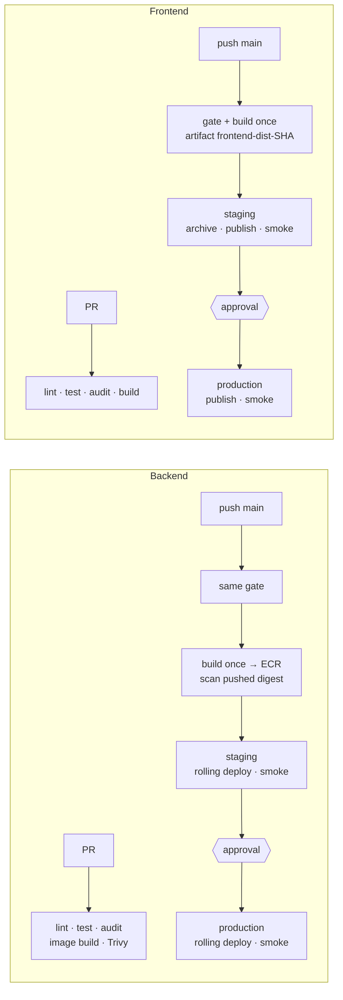

# Problem 4: Ship It Twice

Two GitHub Actions pipelines that take a commit on `main` to production without manual steps:

- **Backend** (HTTP API on EC2): build one container image, push it to ECR, roll it across staging, then production, one instance at a time. Each instance is drained from the load balancer and health-checked, with automatic rollback.
- **Frontend** (static SPA on S3): build one bundle and publish the same bundle to staging, then production. Assets go up before `index.html`, then CloudFront is invalidated, with automatic rollback.

Production needs a human approval. AWS access uses short-lived OIDC credentials, never stored keys. Every job runs on an ephemeral **AWS CodeBuild-hosted runner** in our own AWS account, not on GitHub's machines.

```
src/problem4/
├── .github/actionlint.yaml      registers the CodeBuild runner labels for actionlint
├── .github/workflows/
│   ├── backend-ci.yml          PR gate: lint, test, npm audit, image build + Trivy
│   ├── backend-deploy.yml      main: gate → build/scan/push once → staging → production
│   ├── backend-rollback.yml    manual: redeploy any earlier SHA
│   ├── _deploy-backend.yml     reusable: rolling deploy + smoke test + auto-rollback
│   ├── frontend-ci.yml         PR gate + builds the release artifact
│   ├── frontend-deploy.yml     main: gate/build once → staging → production
│   ├── frontend-rollback.yml   manual: republish any archived release
│   ├── _deploy-frontend.yml    reusable: two-phase publish + smoke test + auto-rollback
│   └── security.yml            gitleaks (history), dependency review, weekly re-scan
├── backend/                    sample Express API (/healthz reports the deployed SHA), tests, Dockerfile
├── frontend/                   sample SPA with a content-hashing build, tests
├── scripts/                    CI-side deploy, publish and smoke-test scripts
└── deploy/
    ├── codebuild/              Terraform for the two CodeBuild runner projects (gha-ci, gha-release)
    ├── ec2/                    on-instance deploy.sh, SSM document, launch-template user data
    └── iam/                    OIDC trust policy + least-privilege policies for every role
```

> The workflows live under `src/problem4/.github/workflows` because this repo holds all five problems. GitHub only runs workflows from the repo root, so to use them, move the folder to `/.github/workflows`. The `paths:` filters and script paths already assume that location, with the apps staying under `src/problem4/`.

## What "production ready" means here

| Property | How the pipelines provide it |
| --- | --- |
| Nothing reaches users untested | PRs run lint, unit tests, dependency audit, image scan and secret scan. The deploy workflows re-run the same gate on `main` before building. |
| What was tested is what ships | Build once, promote many: one image digest and one frontend bundle go to staging and then production. Images are referenced by digest; ECR tags are immutable. |
| Safe rollout | The backend rolls one instance at a time, drained from the ALB, health-checked, and stopped at the first failure. The frontend uploads assets before the entry point, so no user ever loads an `index.html` whose assets are missing. |
| Fast recovery | Automatic rollback to the previously recorded release when a deploy or smoke test fails. One-click manual rollback to any earlier SHA. |
| Human gate where it matters | The `production` GitHub Environment has required reviewers and a main-only branch rule. Staging deploys automatically. |
| No standing credentials | GitHub OIDC → `AssumeRoleWithWebIdentity`. Each role trusts exactly one repo + environment and can touch only its own bucket, distribution, SSM document or tagged instances. |
| Supply-chain hygiene | Every third-party action is pinned to a full commit SHA. Workflows default to `permissions: {}` and each job asks for the minimum. Images carry SBOM and provenance. Shell never interpolates `${{ inputs }}` directly. |
| Builds run on infrastructure we control | Jobs run on ephemeral AWS CodeBuild runners: one fresh container per job, destroyed afterwards. PR code and release jobs use separate runner projects with separate caches. Release runners sit in private subnets with a fixed egress IP. |
| Predictable operations | Concurrency groups serialise releases per app and never cancel a half-finished rollout. Every job has a timeout. npm and Docker layers are cached. A step summary records what went where. |

## Pipelines



### Backend → EC2

**CI (`backend-ci.yml`)** runs on every PR that touches the backend. It runs `npm ci`, ESLint, the `node:test` suite and `npm audit --omit=dev --audit-level=high`. It then builds the image with Buildx and the GHA layer cache, and fails on any fixable HIGH/CRITICAL CVE found by Trivy.

**Release (`backend-deploy.yml`)** runs on push to `main`:

1. Re-runs the CI gate as a reusable workflow (without the throwaway image build).
2. Builds and pushes `backend:<git-sha>` to ECR with SBOM and provenance, then scans the pushed digest with Trivy.
3. Calls `_deploy-backend.yml` for staging, then for production (the second call waits for approval). Both deploy the same digest.

**Rolling deploy (`_deploy-backend.yml` + `scripts/ssm-rolling-deploy.sh` + `deploy/ec2/deploy.sh`):**

- Reads the currently live image from SSM Parameter Store (`/app/backend/<env>/image`). That is the rollback target.
- Sends the `Backend-Deploy` SSM document to instances tagged `Service=backend, Environment=<env>`, with `max-concurrency 1` and `max-errors 0`. On each instance, in turn, `deploy.sh`:
  1. pulls the new image *before* draining, so the instance is out of service only for the swap;
  2. deregisters itself from the ALB target group and waits for connection draining;
  3. replaces the container (`docker stop -t 30` sends SIGTERM, and the app finishes in-flight requests);
  4. polls `localhost/healthz` for up to 60 s;
  5. on success, re-registers and waits until the instance is in service. On failure, restarts the previous image, re-registers it and exits 1, which stops the rollout before the next instance.
- The CI side polls the command until it finishes. It treats "0 instances matched" as a failure, because SSM reports that as Success.
- A smoke test through the public URL waits until `/healthz` reports the new git SHA.
- On success, the new digest is written to SSM, so instances the Auto Scaling group launches later boot the same version (`deploy/ec2/user-data.sh`).
- On any failure, the previous digest is rolled across all instances again, and the job still fails so the team is notified.

The SSM document only accepts an ECR image *pinned by digest* and a target-group ARN (`allowedPattern`), so even a stolen deploy role cannot inject shell commands or run an arbitrary image.

### Frontend → S3 + CloudFront

**CI (`frontend-ci.yml`)** runs lint, tests, `npm audit` and `npm run build`. The build content-hashes every asset (`assets/app.6e3cc1b7c3.js`) and writes `manifest.json` containing the git SHA. The `dist/` folder is uploaded as the artifact `frontend-dist-<sha>`, which is the only bundle that is ever deployed.

**Release (`frontend-deploy.yml` → `_deploy-frontend.yml` → `scripts/publish-frontend.sh`)**, per environment:

1. Downloads the artifact and checks that `manifest.json` names the expected SHA.
2. Archives it to `s3://<releases-bucket>/frontend/<sha>/`. That archive is the rollback source.
3. Writes `config.json` (environment name, API URL) for this environment. Because of this, one build serves every environment.
4. Syncs `assets/` with `Cache-Control: public, max-age=31536000, immutable`. It never uses `--delete`: browsers still holding the previous `index.html` need the previous assets, and keeping them makes rollback instant.
5. Uploads `index.html`, `config.json` and `manifest.json` with `no-cache, no-store, must-revalidate`.
6. Invalidates only those entry points in CloudFront and waits for the invalidation to finish.
7. Smoke test: the live `manifest.json` must report the new SHA, and every asset referenced by the live `index.html` must return 200.
8. On failure, republishes the previously live release from the archive.

### Rollback

| | Automatic | Manual |
| --- | --- | --- |
| Backend | Per instance, `deploy.sh` restores the previous container. Per environment, the job re-rolls the previous digest. | `backend-rollback` (`workflow_dispatch`): pick the environment and a full SHA. It resolves the digest in ECR and runs the same rolling deploy. Production still needs approval. |
| Frontend | The job republishes the previously live release. | `frontend-rollback`: republishes `releases/<sha>`. The old hashed assets are still in the bucket, so this is effectively an `index.html` swap. |

### Build runners: AWS CodeBuild

Every job runs on a **CodeBuild-hosted GitHub Actions runner**, not on a GitHub-hosted VM. A job asks for one with a label:

```yaml
runs-on: codebuild-gha-release-${{ github.run_id }}-${{ github.run_attempt }}
```

When the job is queued, GitHub sends a `WORKFLOW_JOB_QUEUED` webhook to the CodeBuild project named in the label (`gha-release`). CodeBuild starts a fresh container that registers as a runner for that one job, runs it, and is destroyed. Nothing carries over between jobs, and there is no runner fleet to patch or scale. The run ID and attempt in the label tie each container to its own run.

There are two runner projects (`deploy/codebuild/runners.tf`), split by how much the job is trusted:

| Project | Used by | Network | Why separate |
| --- | --- | --- | --- |
| `gha-ci` | `backend-ci`, `frontend-ci`, `security`, `frontend-rollback` input check | CodeBuild default (no VPC) | Runs code from any PR, so it gets no AWS permissions and nothing to reach. |
| `gha-release` | `backend-deploy` image build, `backend-rollback` lookup, `_deploy-backend`, `_deploy-frontend` | Private subnets in the CI account; egress through NAT (fixed IP) and Network Firewall | These jobs push images and deploy. A separate project means a separate Docker layer cache, so layers built from a PR can never end up in a release image. The fixed egress IP lets ECR, S3 and the ALB-facing smoke tests be locked to known sources. |

**Credentials don't change.** Each CodeBuild service role can only write its own logs, use the GitHub connection and, for `gha-release`, attach network interfaces in the release subnets. Pushing to ECR and deploying still go through `aws-actions/configure-aws-credentials` and the per-environment OIDC roles in `deploy/iam/`, so the trust policies, approvals and environment pinning work exactly as before. A runner on its own can't deploy anything.

**Compared with GitHub-hosted runners:**

- **Gained:** builds run in our account and network, with logs in CloudWatch and every API call in CloudTrail. There's a fixed egress IP. Compute size is chosen per project. Billing is per build minute on the AWS bill.
- **Cost:** a cold start of roughly 30–60 s per job while CodeBuild provisions the container (less with reserved capacity fleets). We also own the build image choice (`aws/codebuild/standard:7.0`, Ubuntu with Docker, jq and AWS CLI) and must keep it current. Jobs need `privileged_mode` for the Docker daemon (Buildx and the gitleaks container). That is acceptable because each container is single-use.
- **Limit to know:** CodeBuild's webhook can't restrict which branch may use `gha-release`, so a PR could edit a workflow to request it. That is safe because the release runner has no deploy rights of its own: those come only from OIDC roles pinned to the `staging` / `production` GitHub Environments, and `production` only accepts `main`.

### Security workflow

`security.yml` runs gitleaks over the full git history on every PR and every push to `main`. It uses the CLI image, because `gitleaks-action` needs a paid licence for organisation repos. On PRs it also runs dependency review (fail on HIGH). A weekly schedule re-scans unchanged code against newly disclosed issues.

## Assumptions, and why

| Assumption | Why |
| --- | --- |
| The backend runs as a Docker container on EC2 instances in an Auto Scaling group behind an ALB, instances tagged `Service`/`Environment` | The brief says "deployed to EC2". Containers give an immutable, scannable artifact and identical runtime everywhere, without moving to ECS. |
| Deployment is done with SSM Run Command, not SSH and not CodeDeploy | No inbound SSH and no SSH keys in CI. Every command is audited in CloudTrail and its output goes to CloudWatch. CodeDeploy is the stronger option at larger scale (see below), but needs more infrastructure than this brief justifies. |
| Two environments, `staging` and `production`, ideally in separate AWS accounts | That's the minimum for a pre-production check. Separate accounts limit the blast radius. Roles and variables are per GitHub Environment, so this works either way. |
| ECR lives in a shared tooling account; staging and production pull cross-account | Build once, promote the same digest everywhere. |
| AWS infrastructure (ASG, ALB, buckets, CloudFront with OAC, SSM document, IAM roles, OIDC provider) is provisioned separately with Terraform | Pipelines deploy *applications*. Letting them change infrastructure would widen what the deploy roles can do. `deploy/` contains what Terraform would create. |
| CI runs on AWS CodeBuild-hosted runners in the shared services / CI account, with a GitHub App connection (AWS CodeConnections) to the repo | Keeps builds on infrastructure we control and audit, with a fixed egress IP, without running a self-managed runner fleet. |
| Trunk-based development: PRs into `main`, and `main` is always releasable | The simplest model that supports continuous delivery with an approval gate. |
| Node 22 LTS for both apps | Current LTS. The brief didn't name a stack, so the sample apps are deliberately tiny. |

### One-time setup the workflows expect

- **GitHub Environments** `staging` and `production`. Give production required reviewers and a deployment branch rule of `main` only.
- **Repository variables:** `AWS_REGION`, `AWS_ECR_ROLE_ARN`, `ECR_REPOSITORY`.
- **Variables in each environment:** `AWS_DEPLOY_ROLE_ARN`, `BACKEND_URL`, `BACKEND_TARGET_GROUP_ARN`, optionally `BACKEND_SSM_DOCUMENT`; and `AWS_FRONTEND_ROLE_ARN`, `SITE_URL`, `SITE_BUCKET`, `RELEASES_BUCKET`, `CLOUDFRONT_DISTRIBUTION_ID`, `API_BASE_URL`.
- **No secrets.** Everything above is a non-secret identifier.
- **Branch protection on `main`:** require `backend-ci`, `frontend-ci` and `security` to pass.
- **CodeBuild runners** (CI account): create an AWS CodeConnections GitHub connection and approve it in the console, then `terraform apply` `deploy/codebuild/runners.tf` with the repo URL, connection ARN and the release VPC and subnets. This creates both runner projects and their webhooks.
- **AWS:** create the IAM roles from `deploy/iam/` (each trust policy pinned to `repo:<owner>/<repo>:environment:<env>`). The instance role also needs the `AmazonSSMManagedInstanceCore` managed policy. Make ECR tags immutable and turn on scan-on-push. The site bucket is private behind CloudFront OAC, with versioning on.

## How this was verified (no AWS account available)

| Check | Result |
| --- | --- |
| `actionlint` 1.7.12 (includes shellcheck on every `run:` block) on all 9 workflows, with the CodeBuild labels registered in `.github/actionlint.yaml` | 0 findings |
| `terraform validate` (Terraform 1.14, AWS provider 6.x) on `deploy/codebuild/runners.tf` | valid |
| `shellcheck` on all scripts in `scripts/` and `deploy/ec2/` | 0 findings |
| Every pinned action's `action.yml` fetched at its SHA; inputs and outputs used were checked against it | all valid |
| Backend: ESLint, `node --test` (3 tests), `npm audit` | pass, 0 vulnerabilities |
| Frontend: ESLint, `node --test` (2 tests: hashed references, reproducible build), `npm audit`, build | pass, 0 vulnerabilities |
| Backend image built and run locally: `smoke-test-backend.sh` against it, Docker `HEALTHCHECK`, runs as `node`, stops cleanly on SIGTERM | pass |
| Trivy (same flags as CI) on the image | 10 HIGH CVEs at first, all in the npm/corepack tooling bundled with `node:22-alpine`. Removed from the runtime stage → 0. |
| `smoke-test-frontend.sh` against the built bundle served locally | pass |
| IAM policy JSON | valid JSON. Not validated by IAM Access Analyzer (needs an account). |

**Not exercised:** anything that talks to AWS (CodeBuild runner registration and webhooks, OIDC role assumption, ECR push, SSM Run Command, ALB drain and register, S3 and CloudFront) and the GitHub-hosted parts (Environments, approvals, artifact passing between reusable workflows). These are written against the documented CLI and API behaviour and are the first thing to test in a sandbox account.

## Deliberately left out

| Left out | Why / what I'd do with more scope |
| --- | --- |
| CodeDeploy blue/green with ASG replacement | Better at scale: whole new instances, instant traffic shift, built-in alarm-based rollback. More infrastructure and slower deploys. The SSM rolling approach is transparent and enough for a small fleet. I'd switch when the fleet grows or zero-capacity-loss deploys are required. |
| Canary / progressive delivery (weighted target groups, CloudWatch-alarm-driven promotion) | Needs real traffic and SLO metrics to be meaningful. The rolling deploy plus smoke test is the honest baseline. |
| Database migrations | There is no database in the brief. With one, migrations would run as a separate, backwards-compatible step (expand, deploy, contract) before the rollout. |
| Infrastructure pipelines (Terraform plan on PR, apply on merge) | Separate concern, separate roles. Mixing them would give the app deploy roles infrastructure rights. |
| E2E browser tests (Playwright) against staging | Valuable, but the sample app has no user flows. The hook point is after the staging smoke test, before the production approval. |
| Pruning old frontend assets | Kept on purpose for rollback and for clients with an old `index.html` cached. A scheduled job could remove assets not referenced by the last N releases. |
| Image signing (cosign) + admission check on the instance | Provenance is already attached. Verifying a signature in `deploy.sh` is the next supply-chain step. |
| Dependabot / Renovate config | Needed to keep the SHA-pinned actions, the base image digest and npm deps current. Omitted only to keep the submission small. |
| Notifications (Slack / Teams on failure or approval) | Organisation-specific. GitHub already notifies on failed runs and pending approvals. |
| Race with ASG scale-out during a deploy | An instance launched mid-rollout boots the *previous* image, because the SSM pointer is updated only after success. It converges on the next deploy. A fix would be suspending `Launch` during rollouts, or moving to CodeDeploy. Accepted for now. |
