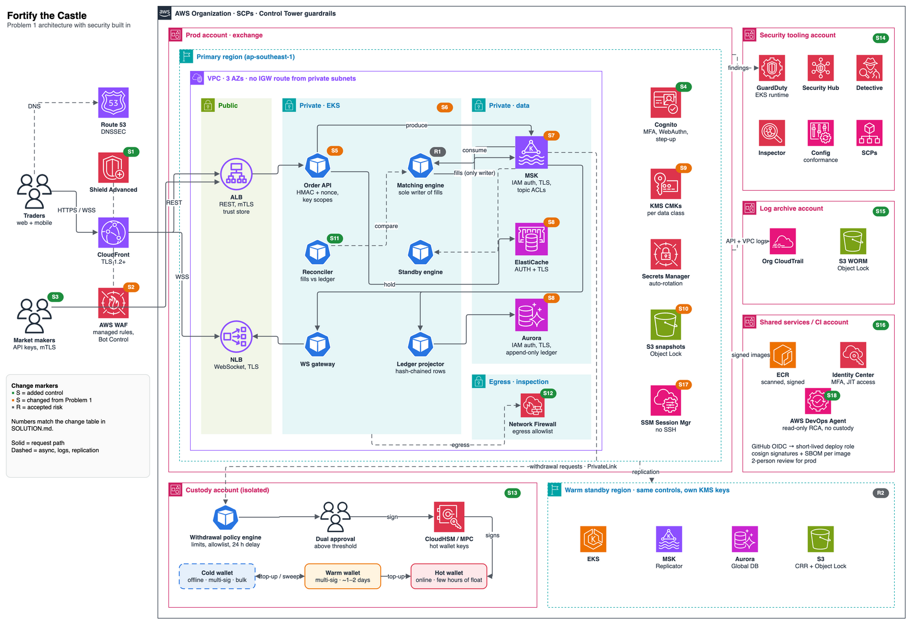

# Problem 5 — Fortify The Castle

This takes the [Problem 1 exchange architecture](../problem1/SOLUTION.md) and builds security into it. The guiding principle: **the two things an exchange cannot survive are losing customer funds and corrupting the ledger.** So controls are prioritised by how directly they protect the hot wallet keys and the integrity of fills and balances. Availability and data confidentiality come next.

Editable source: [`diagrams/fortified-castle.drawio`](diagrams/fortified-castle.drawio). Every badge on the diagram matches a row in the [change table](#2-changes-to-the-architecture):

| Marker | Meaning |
| --- | --- |
| **S** green | **[ADDED]** a new component or control |
| **S** orange | **[CHANGED]** an existing Problem 1 component, now configured differently |
| **R** grey | **[ACCEPTED RISK]** a deliberate decision not to add a control |

---

## 1. Threat model

### What we protect, ranked

| # | Asset | Worst case | Why it ranks here |
| --- | --- | --- | --- |
| 1 | **Hot wallet signing keys** | Funds drained on-chain in minutes, irreversibly | Crypto withdrawals can't be recalled. This is how most exchange breaches end. |
| 2 | **Ledger and balance integrity** | Balances inflated, then withdrawn; double spends | A forged credit becomes a real withdrawal |
| 3 | **Order-flow fairness** (the matching engine as sole writer of fills) | Forged fills, front-running, an insider trading against customers | Market integrity, and a regulatory issue |
| 4 | **Customer accounts and API keys** | Account takeover, unauthorised trades and withdrawals | The most frequent attack in practice (credential stuffing, phishing, leaked keys) |
| 5 | **PII and KYC documents** | Data breach, regulatory fines | Confidentiality, but not directly loss of funds |
| 6 | **Availability** | Outage during volatility; customers can't exit positions | Reputational and legal, but recoverable |

### Who attacks, and how

| Actor | Likely attack | Main controls |
| --- | --- | --- |
| External attacker | Exploit an internet-facing service, pivot to wallet keys | S1, S2, S6, S12, S13 |
| Credential stuffer or phisher | Take over accounts, withdraw funds | S4, S5, S13 (withdrawal delay and allowlist) |
| Leaked or abused API key | Trades or withdrawals from a stolen market-maker key | S3, S5 (scopes, IP allowlist, HMAC) |
| Malicious market maker or bot | Flood one pair, quote stuffing, DoS | S1, S2, per-key limits in S5, admission control from Problem 1 |
| Insider (engineer or operator) | Edit balances, inject fills, steal keys | S7, S11, S13, S14, S15, S17, dual control |
| Compromised CI or dependency | Ship a backdoored image to the engine or the withdrawal service | S16 |
| Compromised cloud credentials | Disable logging, exfiltrate data, create resources | S14 (SCPs), S15 (immutable logs), S9 |
| Prompt injection through telemetry | Hide attacker-controlled text (User-Agent, client order IDs, withdrawal memos) in logs to steer the AI ops agent | S18 (read-only, no custody, human approval) |

---

## 2. Changes to the architecture

Grouped by layer, following the request path from the internet inward.

### Edge

| ID | Change | What it protects against | Latency impact |
| --- | --- | --- | --- |
| **S1** [ADDED] | **Shield Advanced** on CloudFront, the ALB, the NLB and Route 53, with the Shield Response Team engaged and cost protection. **Route 53 DNSSEC.** | Volumetric and layer-7 DDoS during volatility, when attackers know an outage hurts most. DNS hijack that sends users to a phishing clone. | None (in-line at AWS edge) |
| **S2** [CHANGED] | **WAF goes from basic rate rules to:** AWS managed rule groups (core, known-bad-inputs, IP reputation, anonymous IP), Bot Control (targeted) on login and signup, Account Takeover Prevention on `/login`, geo-blocking for sanctioned regions, rate-based rules per IP **and** per API key header. | Credential stuffing, scraping, injection, sanctioned-jurisdiction access | ~1 ms |
| **S3** [ADDED] | **Market makers connect directly to the ALB with mutual TLS** (ALB mTLS verify mode, trust store of client certificates we issue), bypassing CloudFront. Every request is also **HMAC-SHA256 signed** over method, path, body, timestamp and nonce. | A stolen API secret alone is useless without the client certificate. A captured request can't be replayed. | Handshake on new connections only. Market makers keep connections alive, so there's no per-request cost. |

### Identity and access

| ID | Change | What it protects against |
| --- | --- | --- |
| **S4** [ADDED] | **Cognito user pool** (or the existing IdP) with mandatory MFA. WebAuthn/passkeys preferred, TOTP fallback, **no SMS**. **Step-up authentication** for withdrawals, API key creation, address-book changes and security-setting changes. Short-lived access tokens (15 min) and refresh-token rotation. | Account takeover from phished or reused passwords; SIM-swap |
| **S5** [CHANGED] | **Order API** now: verifies the HMAC and rejects timestamps more than 5 s off; keeps a **nonce cache in Redis** (TTL 10 s) against replay; enforces **API key scopes** (`read`, `trade`, `withdraw`, with `withdraw` off by default and never combined with `trade` on market-maker keys); enforces a **per-key IP allowlist**; applies **per-key and per-account rate limits**. JWTs are verified locally against a cached JWKS, so Cognito isn't on the hot path. | Leaked keys, replay, privilege creep, one client starving others |

### Network and accounts

| ID | Change | What it protects against |
| --- | --- | --- |
| **S14** [ADDED] | **Multi-account AWS Organization** via Control Tower: separate **prod**, **custody**, **security tooling**, **log archive**, **shared services/CI**, and non-prod accounts. **SCPs** deny: leaving the org, disabling CloudTrail, GuardDuty or Config, deleting KMS keys, creating IAM users or access keys, using regions outside the allowlist, and public S3 or snapshot sharing. | A compromised prod credential can't reach custody keys, delete the audit trail, or switch off detection. Blast radius is limited to one account. |
| **S12** [ADDED] | **No direct internet egress from private subnets.** All outbound traffic goes through **AWS Network Firewall** with a domain allowlist (blockchain node providers, sanctions-screening API, nothing else). AWS APIs are reached through **VPC endpoints with endpoint policies** that only allow our own accounts and buckets. | Data exfiltration and command-and-control from a compromised pod; supply-chain malware calling home |
| — [CHANGED] | **Security groups per service**, referencing each other rather than CIDRs. For example, only Order API pods may reach MSK producer ports, and only the ledger projector may reach Aurora writer port 5432. Implemented with Security Groups for Pods. | Lateral movement |

### Workloads (EKS)

| ID | Change | What it protects against |
| --- | --- | --- |
| **S6** [CHANGED] | **EKS hardening:** private API endpoint only; **EKS Pod Identity** with one IAM role per service (least privilege); **Pod Security Standards "restricted"** (non-root, read-only root filesystem, no privilege escalation, seccomp default); **default-deny Kubernetes NetworkPolicies** with explicit allows; **Bottlerocket** nodes; envelope encryption of Kubernetes secrets with KMS; **Kyverno admission policy that only admits images signed by our CI key** (cosign) from our ECR. | Container escape, pod-to-pod lateral movement, a stolen node credential reaching AWS, running an unsigned or tampered image |
| **S17** [CHANGED] | **No SSH and no bastion.** Node and debug access goes through **SSM Session Manager** with session logging to the log-archive account, gated by Identity Center just-in-time access. | Untracked interactive access, especially by insiders |

### Data

| ID | Change | What it protects against |
| --- | --- | --- |
| **S7** [CHANGED] | **MSK: IAM authentication and TLS in transit, plus per-topic ACLs.** Only the **matching engine's role may write** `fills` and `depth`; only the Order API may write `orders`; consumers are read-only. Topic configuration changes need a separate admin role. | **A compromised gateway or projector can't forge fills.** This makes "the engine is the sole writer" an enforced control, not just a convention. |
| **S8** [CHANGED] | **ElastiCache:** AUTH (RBAC users) plus in-transit and at-rest encryption. **Aurora:** IAM database authentication, TLS required, a separate DB role per service. The ledger tables are **append-only**: the application role has `INSERT` and `SELECT` only, no `UPDATE` or `DELETE`. | Credential theft from config; silent balance edits |
| **S9** [CHANGED] | **Customer-managed KMS keys per data class**: ledger, PII/KYC, snapshots, logs, custody (in the custody account). Key policies separate *key admins* from *key users*. **Secrets Manager** with automatic rotation for anything not covered by IAM auth. | One key compromise exposing everything; long-lived secrets |
| **S10** [CHANGED] | **Engine snapshots and audit exports go to S3 with Object Lock** (compliance mode, 1-year retention), versioning, and Block Public Access at the account level. | Ransomware or an insider deleting or tampering with the replay source and evidence |

### Ledger integrity

| ID | Change | What it protects against |
| --- | --- | --- |
| **S11** [ADDED] | **Hash-chained ledger and an independent reconciler.** Each ledger batch stores `hash(prev_hash ‖ batch)`. The fill stream carries engine sequence numbers. A separate **reconciler** service, running under its own role with read-only access, continuously replays fills, compares them with the ledger, and checks that every account's balances sum to zero. Any mismatch **halts withdrawals automatically** and pages on-call. | Any tampering or bug that creates money; it's detected in minutes, before the money can be withdrawn |

### Custody (not in Problem 1 — added as a component)

| ID | Change | What it protects against |
| --- | --- | --- |
| **S13** [ADDED] | **Isolated custody account** with a **withdrawal policy engine** that consumes withdrawal requests over **PrivateLink**. It is the only path to signing. Rules: per-user and global velocity limits; address allowlist with a 24-hour activation delay for new addresses; sanctions and chain-analytics screening; a 24-hour lock after password, MFA or API-key changes; **dual human approval above a threshold**. **Signing keys live in CloudHSM or an MPC signer** and are never exported. **Hot / warm / cold split:** the hot wallet holds only a few hours of withdrawal volume; most funds sit in multi-sig cold storage offline. | **The main loss scenario.** Even full compromise of the prod account can't sign a transaction outside policy, and the hot float caps the worst case. |

#### Hot, warm and cold wallets

A crypto wallet is just a set of private keys: whoever can sign with the key can move the coins, and an on-chain transfer can't be reversed. Any key that is online and signs automatically can be abused by an attacker who gets far enough in. Any key that is offline is safe but slow to use. No single wallet can be both fast and safe, so funds are split into three tiers. The bottom row of the custody account in the diagram shows them:

| Tier | In the diagram | Holds | How it signs | Why it exists |
| --- | --- | --- | --- | --- |
| **Hot** | Red box, signed by **CloudHSM / MPC** | A few hours of expected withdrawals | Online and automatic, after the policy engine (and dual approval above the threshold) | Lets normal withdrawals go out in seconds. Because it holds so little, it caps what an attacker can steal if every other control fails. |
| **Warm** | Orange box | Roughly 1–2 days of withdrawals | Multi-sig, with keys held by separate custody staff; signs on request in minutes to hours | A buffer that refills the hot wallet without touching cold storage every day. Stealing from it needs several people or keys at once. |
| **Cold** | Blue box with a **dashed border** (offline: no network, so nothing on AWS to draw) | The bulk of customer funds (typically 90%+) | Offline multi-sig on air-gapped hardware, keys split across people and locations; a scheduled ceremony takes hours | Keeps most funds out of reach of any network attack, including a full AWS compromise. |

Funds move between the tiers along the arrows:

- **Top-up:** when the hot wallet falls below its floor, the warm wallet refills it. When the warm wallet runs low, a cold-storage ceremony refills it. Both are planned from withdrawal forecasts so that customers never wait on cold storage.
- **Sweep:** customer deposits and any hot or warm balance above its ceiling are moved back to cold storage on a schedule, so the online float stays small.
- **Alerts:** hot and warm balances are monitored against their floor and ceiling. An unexpected drop pages on-call and halts withdrawals, the same as a reconciler mismatch (S11).

The trade-off is speed for the rare large withdrawal: if it exceeds the hot float, it waits for a warm top-up, which adds minutes to hours. This is the same trade-off as dual approval, and it only affects a small share of withdrawals by count.

### Detection, response and audit

| ID | Change | What it protects against |
| --- | --- | --- |
| **S15** [ADDED] | **Log archive account:** organisation-wide **CloudTrail** (management + S3/KMS data events), VPC Flow Logs, EKS audit logs, WAF logs and Session Manager logs. All go to S3 with **Object Lock**, readable only by the security team. | Attackers or insiders covering their tracks; forensic gaps |
| **S14** (security account) | **GuardDuty** (including EKS audit-log and runtime monitoring, S3 and RDS protection), **Security Hub** (FSBP and CIS standards), **Config** conformance packs, **Inspector** (ECR and EC2), and **Detective** for investigation. Delegated admin lives in the security account, so prod admins can't silence findings. Critical findings page on-call; withdrawal-related findings also trigger the withdrawal circuit breaker. | Undetected compromise; configuration drift |
| **S18** [ADDED] | **AWS DevOps Agent for operational diagnosis**, plus **SLOs for the security controls** (below). The Agent Space lives in the shared services account. Its role in prod is read-only and explicitly denies `secretsmanager:GetSecretValue`, `kms:Decrypt`, reads of the KYC and snapshot buckets, and database connections. It has **no access to the custody account**. Custody exports only aggregate metrics (queue depth, approval latency) through CloudWatch cross-account observability. No write-capable MCP tools are connected. The agent's findings never trigger automation: for example, it can't resume halted withdrawals. Its API calls land in the org CloudTrail (S15). | A slow, guesswork diagnosis while withdrawals are halted or an SLO is burning. Also limits the AI agent's own risks: an LLM reading attacker-influenced logs can be wrong or manipulated, so it can only advise. |
| — [ADDED] | **Runbooks and game days:** key compromise, API-key leak, a suspicious-withdrawal spike, a reconciler mismatch, and region failover. **Break-glass:** two sealed IAM Identity Center emergency accounts with hardware MFA, alarmed on use. | Slow, improvised incident response |

### Security SLOs and AI-assisted diagnosis (S18)

Problem 1 sets SLOs for trading. The security controls need their own, because a control that is silently slow is effectively off. A reconciler running 10 minutes behind is 10 minutes of withdrawable forged balance.

| Control | SLI: good event | SLO (28 days) | Why |
| --- | --- | --- | --- |
| Reconciler (S11) | A minute in which reconciliation lags fills by less than 60 s | 99.9% | Caps how long a forged credit can go unnoticed |
| Withdrawals (S13) | A withdrawal within the hot float that is screened, signed and broadcast within 15 min. Policy holds such as new-address delays and dual approval don't count. | 99% | Customers can always exit. Halts and holds are deliberate, but slowness isn't. |
| Detection (S14) | A critical GuardDuty or Security Hub finding that pages on-call within 5 min. Measured with sample findings generated hourly as canaries. | 99.9% | Proves the detection pipeline works end to end, not just that it's switched on |
| Audit trail (S15) | A CloudTrail log file delivered to the log archive within 15 min | 99.9% | A gap in the trail is a forensic blind spot |

These use the same burn-rate alerting as Problem 1. When one burns, or the reconciler or a balance alarm halts withdrawals, an **AWS DevOps Agent** investigation starts with the page. The agent looks for the *operational* cause: for example, ledger projector lag behind the reconciler, a blockchain node provider timing out, Network Firewall blocking a provider's new endpoint, or a deploy that changed the screening client. On-call can then fix it and an authorised human can resume withdrawals sooner. Security incidents stay with GuardDuty, Detective and the security team. The agent is an ops tool, not part of incident response for attacks.

Why the agent is trusted this far and no further:

- **Read-only, with human approval.** The service blocks write operations at its tool layer, and any proposed mitigation needs explicit approval. On top of that, our IAM denies keys, secrets and customer data, so even a manipulated agent has nothing valuable to read and nothing to change.
- **Untrusted input.** Logs carry attacker-controlled strings, and the agent can be wrong. Its findings are labelled root cause, contributing cause or hypothesis, with evidence. Humans verify them before acting, and nothing automated keys off its output.
- **No custody.** Key handling stays an AI-free zone. Custody is investigated by the custody team from its own logs, and the agent sees only aggregate metrics.
- **Data.** Logs are PII-free at the source, which was already needed for S15. AWS states that agent data isn't used to train models, and investigation history is kept for audit.

### CI/CD supply chain

| ID | Change | What it protects against |
| --- | --- | --- |
| **S16** [ADDED] | GitHub Actions authenticates with **OIDC** to short-lived deploy roles (no static AWS keys). Protected `main` branch with required reviews and **two-person approval for prod deploys**. Dependency pinning and Dependabot. **SBOM generated per image.** Images **signed with cosign** (KMS-backed key) and verified at admission (S6). ECR immutable tags and scan-on-push. Prod deploys via ArgoCD pull, so CI never holds cluster-admin. | Backdoored builds, stolen CI secrets, a single engineer shipping to prod alone |

### Accepted risks

| ID | Decision | Why it's acceptable |
| --- | --- | --- |
| **R1** [ACCEPTED RISK] | **No service-mesh mTLS between pods on the matching hot path** (Order API ↔ MSK ↔ engine). Traffic to MSK, Redis and Aurora is TLS, and pod-to-pod is restricted by NetworkPolicy and security groups, but no sidecar mTLS. | A sidecar adds 1–3 ms per hop at p99 and adds operational risk to the most latency-sensitive path. The data stores already enforce TLS and IAM identity (S7, S8). Lateral movement is limited by S6 and S12. Revisit if we ever need zero trust inside the cluster for compliance. |
| **R2** [ACCEPTED RISK] | **The standby region is warm, not active-active**, so a region loss means ~15 min RTO. | Active-active matching would break single-writer correctness (Problem 1). The standby gets the same controls and its own KMS keys, so failover doesn't weaken security. |
| — [ACCEPTED RISK] | **PII is encrypted with KMS but not tokenised** at launch. | Data is encrypted, access-logged and restricted to the KYC service role. Tokenisation (a separate vault) goes in Phase 2 when the KYC volume justifies it. |

### Latency check (p99 < 100 ms still holds)

| Added on the request path | p99 cost |
| --- | --- |
| WAF managed rules + Bot Control | ~1 ms |
| HMAC verify + nonce lookup in Redis | < 1 ms |
| TLS to MSK and Redis (sessions reused) | < 1 ms |
| ALB mTLS (new connections only) | 0 ms on kept-alive connections |
| **Total added** | **~2–3 ms** on the ~30–50 ms budget from Problem 1 |

Network Firewall sits only on the egress path and the reconciler is asynchronous, so neither touches order latency.

---

## 3. Priorities

### Refuse to ship without

These aren't negotiable for launch, because a gap in any of them can lose customer funds or make a breach undetectable:

1. **Custody isolation with a withdrawal policy engine, HSM/MPC keys, a small hot float and dual approval** (S13)
2. **The matching engine as the only writer of fills, enforced by MSK ACLs** (S7), plus an **append-only ledger** (S8)
3. **The reconciler with an automatic withdrawal halt** (S11)
4. **Mandatory strong MFA, step-up for withdrawals, and the new-address delay** (S4, S13)
5. **Multi-account separation with SCPs, and immutable org-wide CloudTrail** (S14, S15)
6. **Signed images and OIDC-based CI with two-person prod approval** (S16)
7. **Shield Advanced and WAF in front of everything public** (S1, S2)

### Roadmap

| Phase | Items | Reasoning |
| --- | --- | --- |
| **Must-have before launch** | Everything in the list above, plus S5, S6, S8, S9, S10, S12, S17, GuardDuty, Security Hub, Config, runbooks and break-glass, and the security SLOs with burn-rate alerts and DevOps Agent investigations (S18) | These protect funds, ledger integrity and detection, and are cheap compared with a breach |
| **Phase 2 (first 3–6 months)** | Market-maker mTLS rollout to all API clients (S3 is offered from day one, mandatory later); PII tokenisation vault; Macie on KYC buckets; Detective-driven threat hunting; external pentest and bug bounty; SOC 2 / ISO 27001 readiness; chaos and security game days in prod | Valuable, but they depend on traffic patterns, partners and volume we don't know yet |
| **Deferred** | Service-mesh mTLS inside the cluster (R1); active-active regions (R2); a dedicated 24/7 SOC (use an MDR partner first); proof-of-reserves publication tooling | Either cost latency on the hot path, conflict with correctness, or are only needed at a larger scale |

---

## 4. Assumptions and missing facts

| Fact I'd need | Why it matters | How I'd get it | Assumed for now |
| --- | --- | --- | --- |
| Jurisdictions and licences (e.g. MAS, VARA, MiCA) | Drives data residency, KYC retention, custody rules, audit requirements | Legal and compliance team | Singapore-based (ap-southeast-1); MAS-style custody and travel-rule requirements |
| Custody model: self-custody vs a qualified custodian | Changes whether S13 is built or bought | Business decision with the CFO and compliance | Self-custody with HSM/MPC; integration-ready for a custodian |
| Daily withdrawal volume and the value distribution | Sizes the hot wallet float and the approval thresholds | Finance and projected trading data | Hot float = 4 h of p95 withdrawal volume; approval above USD 50k |
| Market-maker integration constraints (FIX, colocation, certificate handling) | Whether mTLS is mandatory from day one | Talk to launch market makers | Offered on day one, mandatory in Phase 2 |
| Existing identity provider and SSO | Cognito vs reusing an IdP | IT and security | Cognito for customers, IAM Identity Center for staff |
| Team size and on-call capacity | Whether an in-house SOC or an MDR partner | Engineering leadership | Small team; MDR partner plus Security Hub paging |
| Risk appetite for latency vs controls | R1 trade-off | Product and risk owners | p99 < 100 ms is a hard requirement |

---

## 5. What I deliberately left out

- **Application-level secure coding** (input validation, OWASP review of each service). It's assumed to be part of the normal development process and code review, not architecture.
- **Smart-contract and on-chain risks** (token contract bugs, chain reorganisations). Handled by per-asset confirmation policies in the custody team's runbooks, outside this design.
- **Physical and corporate security** (laptops, office, HR processes), beyond requiring hardware MFA for staff.
- **A full compliance control mapping** (SOC 2, ISO 27001, PCI). The controls above cover most of it, but the mapping is Phase 2 work.
- **Cost figures.** The main cost adds are Shield Advanced (~USD 3k/month org-wide), Network Firewall endpoints per AZ and CloudHSM clusters. They're small compared with the value at risk and the cost of a breach, but they should be confirmed with AWS pricing for the actual traffic.
